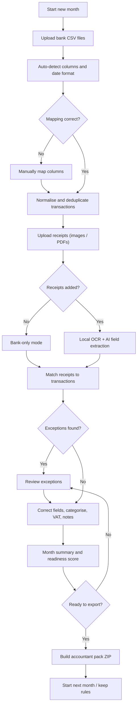

# Month-End Pack — Feature Flow

This is the exact flow of the application, from an empty month to a finished accountant pack. It is a feature flow, not a timeline.

---

## The flow at a glance

---

## Step-by-step flow

### Step 1 — Start a new month

**Feature:** Month setup.

The user chooses the month, the currency (GBP or EUR), and whether they are starting a new pack or continuing the previous one. The app shows where the data is stored on the device.

**Output:** An empty month workspace with local storage confirmed.

---

### Step 2 — Upload bank CSV files

**Features:**

- Drag-and-drop or browse to select files.
- Import one file or multiple files.
- Auto-detect delimiter, encoding, header row, date format, and amount columns.
- Show a preview of the first rows.
- Let the user manually correct the mapping.
- Validate duplicate files, missing dates, invalid amounts, and unsupported currencies.

**Output:** A normalised transaction table with date, description, amount, direction, account, and source file.

---

### Step 3 — Normalise and deduplicate transactions

**Features:**

- Convert every row into one standard transaction format.
- Detect and remove duplicate rows across files.
- Keep the original file and row reference for audit.
- Show a count of imported, skipped, and duplicate transactions.

**Output:** One clean transaction list for the month.

---

### Step 4 — Upload receipts

**Features:**

- Drag-and-drop images or PDFs, or select a folder.
- Support JPG, PNG, and PDF, including multi-page PDFs.
- Show a queue with status: queued, processing, extracted, needs review, failed.
- Detect duplicate receipts by file hash.
- Allow "bank-only mode" if the user has no receipts.

**Output:** A receipt queue linked to the current month.

---

### Step 5 — Extract receipt data with AI

**Features:**

- Local OCR reads each receipt.
- Extract vendor, date, total amount, VAT/tax, currency, payment method, and line items when readable.
- Show a confidence score for every field.
- Highlight low-confidence fields for review.
- Suggest a category for the receipt.
- Save a vendor rule after the user corrects a field.
- Keep the raw OCR text for audit.
- External AI is optional and off by default.

**Output:** Structured receipt records with confidence scores and suggested categories.

---

### Step 6 — Match receipts to transactions

**Features:**

- Exact match: same amount, date within 0–2 days, similar vendor.
- Fuzzy match: same amount, date within 5 days, similar vendor.
- Manual match and unmatch.
- Multiple receipts can be matched to one bank transaction.
- Flag:
  - bank transaction with no receipt,
  - receipt with no bank transaction,
  - duplicate receipt or transaction,
  - amount mismatch,
  - foreign currency,
  - possible personal expense.
- Show a match confidence score.

**Output:** Every transaction and receipt has a match status.

---

### Step 7 — Review exceptions

**Features:**

- Filters: all, needs review, missing receipts, unmatched receipts, duplicates, low confidence.
- Correct vendor, date, amount, VAT, and category.
- Mark an item as personal or excluded.
- Add a note.
- Bulk actions: accept all high-confidence suggestions, set a category for selected items, mark selected items as personal.
- Keyboard-first review: approve and move to the next item.

**Output:** A reviewed month with every item either matched, explained, excluded, or flagged.

---

### Step 8 — Categorise and add VAT treatment

**Features:**

- Default small-business category list.
- AI-suggested category with confidence.
- Manual category override.
- VAT treatment: included, excluded, or not applicable.
- Simple VAT summary, not a VAT return.
- Progress indicator: reviewed X of Y items.

**Output:** A categorised ledger with a VAT summary.

---

### Step 9 — Check the month summary

**Features:**

- Total money in, total money out, and net.
- Totals by category.
- VAT summary.
- Number and value of missing receipts, unmatched receipts, duplicates, and uncategorised items.
- Pack readiness score.
- List of blockers that stop the pack from being ready.

**Output:** A clear answer to "is this month ready for my accountant?"

---

### Step 10 — Export the accountant pack

**Features:**

- Build one ZIP file containing:
  - `transactions.xlsx` — the clean ledger.
  - `summary.pdf` — one-page month summary.
  - `receipts/` — renamed receipt files.
  - `exceptions.csv` — missing, unmatched, duplicate, and uncategorised items.
  - `README.txt` — what is included.
  - `audit.json` — source files, timestamps, confidence, and corrections.
- Export presets: Accountant pack, Spreadsheet only, Review only.
- Save locally. No upload.

**Output:** One ZIP file the user can send to their accountant.

---

### Step 11 — Start next month

**Features:**

- Keep vendor rules, categories, and settings.
- Archive the previous month locally.
- Show a month-over-month summary (optional).
- Export or delete all local data.

**Output:** A repeatable monthly workflow.

---

## Feature map

| Flow step | Feature | Required in v1? |
|---|---|---|
| 1 | Month setup and currency | Yes |
| 2 | Bank CSV import and column mapping | Yes |
| 3 | Normalise and deduplicate transactions | Yes |
| 4 | Receipt import queue | Yes |
| 5 | Local OCR and field extraction | Yes |
| 6 | Receipt-to-transaction matching | Yes |
| 7 | Exception review screen | Yes |
| 8 | Categorisation and VAT treatment | Yes |
| 9 | Month summary and readiness score | Yes |
| 10 | Accountant pack export | Yes |
| 11 | Next-month repeat and rules memory | Yes |
| — | Optional external AI provider | No — after v1 |
| — | German localisation | No — after v1 |
| — | Bank linking / open banking | No — excluded |
| — | Tax filing / VAT submission | No — excluded |
| — | Invoicing, payroll, full accounting | No — excluded |

---

## The core loop

**Import → extract → match → review → export → repeat next month.**

Every feature in the app supports one of those six steps. If a feature does not support one of them, it does not belong in v1.
