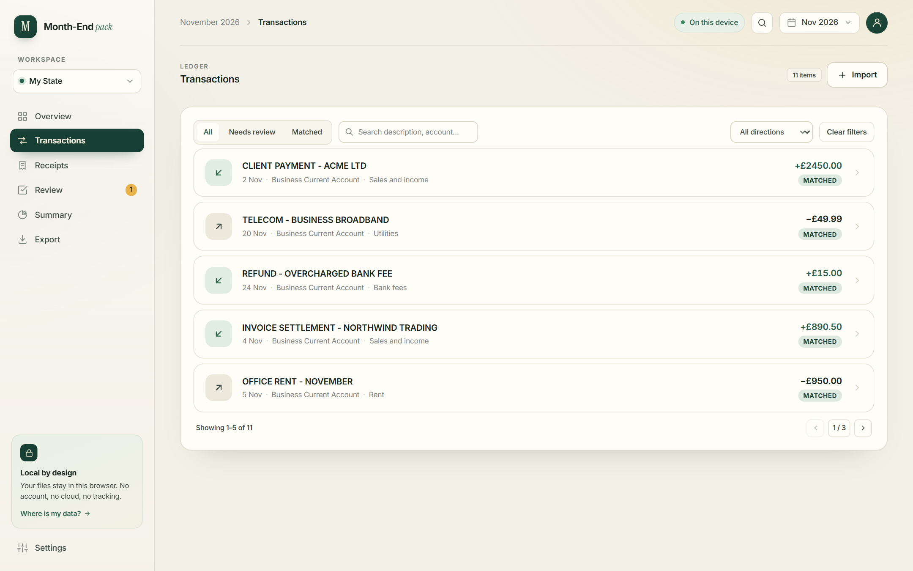
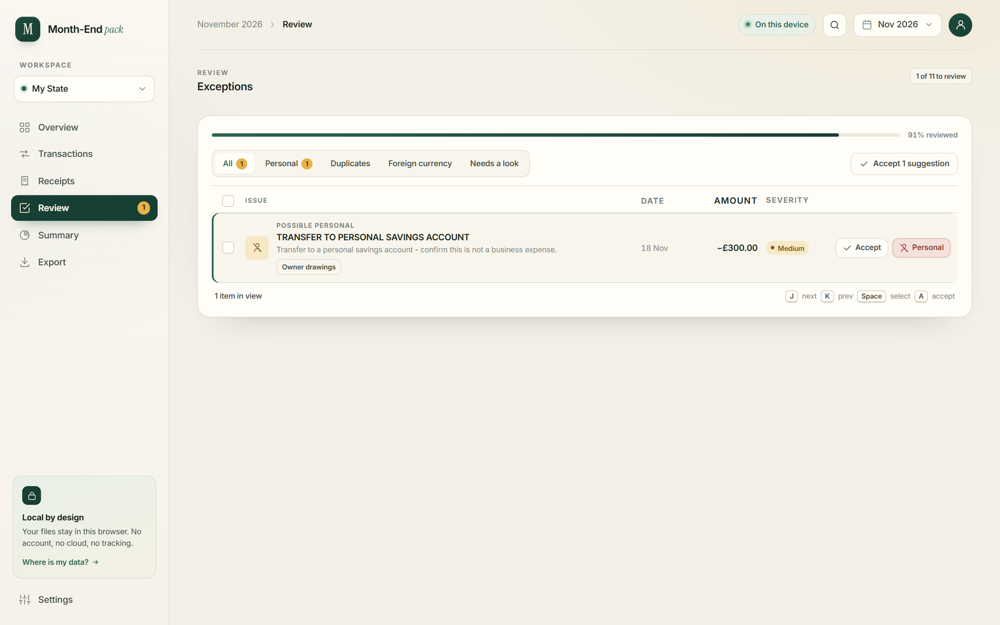

# Month-End Pack — Accountant-ready bookkeeping, locally

**Turn a month of bank statement CSVs and a folder of receipts into a clean, accountant-ready ZIP pack — without uploading your books to the cloud.**

Month-End Pack is a local-first **month-end close** tool for solo owners and micro-businesses (1–10 people) in the UK and Europe. Import bank CSV files, OCR receipts from images or PDFs, match receipts to transactions, review only the exceptions, and export a **bookkeeping pack your accountant can actually use** — an Excel ledger, a one-page PDF summary, the original receipts, an exceptions CSV, a README, and an audit trail.


<p align="center">
  
  
  
  
  
</p>

---

## What is Month-End Pack?

Most bookkeeping tools ask you to move your bank data into their cloud before they will help you. Month-End Pack takes the opposite approach: **your statements and receipts stay in your browser's local storage on your own device, and the finished pack downloads straight to your computer**.

It is built for the monthly handoff that small businesses repeat over and over:

1. Export a CSV from your bank.
2. Drop it into Month-End Pack.
3. Add this month's receipts.
4. Review the handful of items that need a human decision.
5. Export one ZIP and send it to your accountant.

No account. No login. No cloud sync. No subscription. No telemetry.

> **Scope:** Month-End Pack prepares the pack. It does not file taxes, submit VAT returns, or replace full accounting software.

---

## Why Month-End Pack?

- **One clean handoff, not a folder of chaos.** The export is a single ZIP with a ledger, summary, receipts, exceptions, and an audit trail.
- **Review exceptions, not every row.** Exact and fuzzy matching surface only the transactions that need attention — missing receipts, duplicates, personal spending, or unclear amounts.
- **Local-first by design.** Workspace data lives in IndexedDB on your device. Nothing is uploaded by default.
- **Bring your own AI.** Use any OpenAI-compatible provider — OpenAI, OpenRouter, a local Ollama server, or your own endpoint — with your own key.
- **Repeatable every month.** Workspaces, categories, and VAT treatment carry forward, so the second month is faster than the first.
- **A pack your accountant can read.** Consistent file names, a one-page summary, and an audit file explaining where every number came from.

---

## Features

### Bank statement import (CSV)

- Import one file or several CSV files for the same month (for example, one per bank account).
- Auto-detects the delimiter, header row, date format, and amount/description columns.
- Normalises every row into a consistent ledger: date, description, signed amount, direction, account, source file, and original row number.
- De-duplicates transactions across overlapping files using a stable fingerprint.
- Keeps the original file reference for audit.

### Receipt capture and OCR

- Add receipts as JPG, PNG, or PDF, including multi-page PDFs.
- Local OCR runs in the browser with Tesseract.js — receipt images do not leave the device.
- Extracts vendor, date, total, VAT, currency, and payment method, with a confidence score for every field.
- Detects duplicate receipts using a SHA-256 file hash.
- Flags low-confidence extractions for review.
- Supports a **bank-only** workflow when you do not have receipts.

### Matching and exception review

- Matches receipts to bank transactions using amount, date window, and vendor similarity.
- Supports exact matches, fuzzy matches, and manual match/unmatch.
- Flags the things that block a clean close:
  - bank transaction with no receipt
  - receipt with no matching bank transaction
  - duplicate transaction or receipt
  - amount mismatch
  - foreign currency
  - possible personal expense
- Review screen with filters, bulk actions, keyboard shortcuts, and a live **reviewed X of Y** progress bar.
- Accept a suggestion, assign a category, or mark an item as personal/excluded.

### Categories, VAT, and the month summary

- 17 built-in small-business categories, from sales and subcontractors to bank fees and owner drawings.
- Record VAT treatment per transaction: included, excluded, or not applicable.
- See money in, money out, net, spending by category, and a simple VAT summary.
- A **pack readiness** score shows how much of the month is clean.
- A blocker list explains exactly what is stopping the export.

### Export the accountant pack

Choose a preset and download the ZIP locally:

| Preset | What you get |
| --- | --- |
| **Accountant pack** | `transactions.xlsx`, `summary.pdf`, `exceptions.csv`, `README.txt`, `audit.json`, and a `receipts/` folder |
| **Spreadsheet only** | The clean ledger as an Excel workbook |
| **Review only** | An exceptions CSV for a quick review |

The pack is generated entirely in the browser with JSZip, SheetJS, and jsPDF.

### Multiple workspaces and months

- Keep separate workspaces for different businesses, or different clients.
- Switch months with the period picker.
- GBP and EUR support.
- Workspace and period data persist locally between sessions.

### Privacy and trust

- All data is stored in IndexedDB in your browser.
- No account, no cloud sync, no analytics, no tracking, no telemetry.
- Remove an AI provider at any time; clearing site data erases the local workspace.
- AI is opt-in and only runs through the provider you configure.

---

## How it works

```text
Import  →  OCR  →  Match  →  Review  →  Export  →  Repeat next month
```

1. **Create a workspace.** Pick the month, currency, and VAT status.
2. **Import bank CSVs.** The parser detects the format and builds a clean, de-duplicated ledger.
3. **Add receipts.** Local OCR reads each file; your AI provider structures the fields and scores confidence.
4. **Review exceptions.** Month-End Pack matches receipts to transactions and shows only what needs a decision.
5. **Export the pack.** Download one ZIP, send it to your accountant, and start the next month with your settings intact.

---

## Screenshots

| Transactions ledger | Exception review |
| --- | --- |
|  |  |

---

## What's inside the exported pack

| File | Purpose |
| --- | --- |
| `transactions.xlsx` | Clean ledger: date, description, amount, direction, account, category, VAT, receipt, match status, notes |
| `summary.pdf` | One-page month summary: totals, category breakdown, VAT summary, and exceptions |
| `receipts/` | Original receipt files, renamed consistently by date, vendor, and amount |
| `exceptions.csv` | Missing receipts, unmatched receipts, duplicates, and uncategorised items |
| `README.txt` | Plain-language explanation of what is included and how to read it |
| `audit.json` | Source files, import timestamps, extraction confidence, and user corrections |

---

## Tech stack

| Layer | Choice |
| --- | --- |
| Framework | [Next.js 16](https://nextjs.org) (App Router, Turbopack) |
| UI | React 19, TypeScript, CSS Modules, Tailwind CSS v4 |
| State | Zustand |
| Local database | IndexedDB via [`idb`](https://github.com/jakearchibald/idb) |
| CSV parsing | Custom delimiter/date/amount detection |
| Receipt OCR | Tesseract.js + PDF.js |
| Spreadsheet export | SheetJS (`xlsx`) |
| PDF export | jsPDF + jsPDF-AutoTable |
| ZIP export | JSZip |
| AI | Any OpenAI-compatible chat-completions endpoint |

---

## Getting started

### Prerequisites

- Node.js **20.9 or newer** (22 LTS recommended)
- npm
- A modern browser with IndexedDB support

### Install and run

```bash
git clone https://github.com/<your-username>/month-end-close-pack.git
cd month-end-close-pack
npm install
npm run dev
```

Open **http://localhost:5000**. The dev server is configured for port 5000 in `package.json`.

### Production build

```bash
npm run build
npm start
```

### Lint

```bash
npm run lint
```

---

## Configure an AI provider

Month-End Pack does not ship with an API key. Before importing or analysing files, connect an OpenAI-compatible provider in **Settings → AI**:

1. Enter a provider name.
2. Enter the base URL, for example:
   - OpenAI — `https://api.openai.com/v1`
   - OpenRouter — `https://openrouter.ai/api/v1`
   - Ollama (local) — `http://localhost:11434/v1`
3. Paste your API key.
4. Fetch the provider's models and select one.

**What leaves the device:** only the data required for the request — transaction rows for analysis and OCR text for receipt structuring. Receipt images are processed locally and are not uploaded. Requests are sent through the app's own stateless server routes (`/api/ai/analyze`, `/api/ai/extract`, `/api/ai/models`) to avoid browser CORS restrictions. The API key is stored in IndexedDB on your device and is forwarded only to the provider you configured.

---

## Try it with the demo data

The repository includes a sample month in [`test-data/`](test-data):

- [`statement-november-2026.csv`](test-data/statement-november-2026.csv) — 11 transactions, including a £300 transfer to a personal savings account that should be flagged.
- [`receipt-microsoft-365.pdf`](test-data/receipt-microsoft-365.pdf) — a sample receipt for the matching workflow.

To reproduce the screenshot:

1. Create a workspace for **November 2026**, currency **GBP**.
2. Import `statement-november-2026.csv`.
3. Review the £300 transfer flagged as a possible personal expense.
4. Export the accountant pack.

Expected totals: **£4,595.50 in**, **£1,852.33 out**, **£2,743.17 net**, and **91% readiness** with one item to review.

---

## Project structure

```text
month-end-pack/
├── app/
│   ├── page.tsx                 # App shell and view routing
│   ├── overview-screen.tsx      # Readiness hero, pipeline cards, recent activity
│   ├── transactions-screen.tsx  # Searchable / filterable ledger
│   ├── receipts-screen.tsx      # Receipt queue and review
│   ├── exceptions-screen.tsx    # Exception review workflow
│   ├── summary-screen.tsx       # Month totals, VAT, blockers
│   ├── export-screen.tsx        # Pack presets and download
│   ├── settings-screen.tsx      # Workspace, AI, data controls
│   ├── ai-config-tab.tsx        # BYO OpenAI-compatible provider setup
│   ├── db.ts                    # IndexedDB schema (v5)
│   ├── *_store.ts               # Zustand stores for workspace, import, receipts, AI, UI
│   ├── bank-import.ts           # CSV parsing, normalisation, AI analysis
│   ├── receipt-import.ts        # OCR + receipt structuring
│   ├── matching.ts              # Receipt-to-transaction matching
│   ├── summary.ts               # Totals, categories, VAT, readiness
│   ├── export-pack.ts           # XLSX / PDF / CSV / ZIP builder
│   └── api/ai/                  # Stateless server-side AI proxy routes
├── types/                       # Shared TypeScript types and default categories
├── test-data/                   # Sample bank CSV and receipt PDF
├── docs/                        # README screenshots
└── public/                      # Static assets
```

---

## Scripts

| Command | Description |
| --- | --- |
| `npm run dev` | Start the development server on port 5000 |
| `npm run build` | Create a production build |
| `npm start` | Serve the production build |
| `npm run lint` | Run ESLint |

---

## Privacy and data flow

```text
Bank CSV ──► browser parser ──► IndexedDB ──► export (local ZIP)
Receipts ──► local OCR ──► AI structuring ──► IndexedDB ──► export (local ZIP)
                              │
                              └─ only OCR text is sent, never the image
```

- Workspace records, transactions, receipt blobs, import jobs, and AI configuration are stored in the `month-end-pack` IndexedDB database.
- The app makes no analytics or telemetry requests.
- AI requests happen only after you configure a provider and start an import or receipt extraction.
- Export files are assembled in the browser and downloaded directly to your device.
- Clearing site data removes the local workspace; export anything you need first.

---

## Limitations

Month-End Pack is deliberately focused. It is **not**:

- a full double-entry accounting system
- tax filing or VAT return submission software
- invoicing, payroll, or bank-feed software
- a multi-user or cloud collaboration tool
- a currency converter — foreign-currency transactions are flagged, not converted
- a replacement for your accountant

It is a fast, private way to prepare the monthly pack that starts the accountant conversation.

---

## Contributing

Issues and pull requests are welcome. Before opening a PR:

```bash
npm run lint
npm run build
```

Please keep changes focused, follow the existing TypeScript/CSS Module patterns, and include a short description of the problem the change solves.

---

## Status

Early-stage, actively developed. The core workflow — CSV import, receipt OCR, matching, exception review, readiness scoring, and ZIP export — is implemented and working locally.
